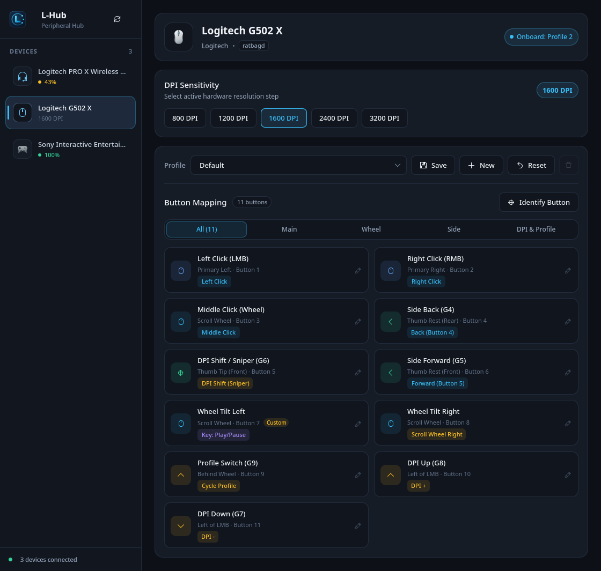
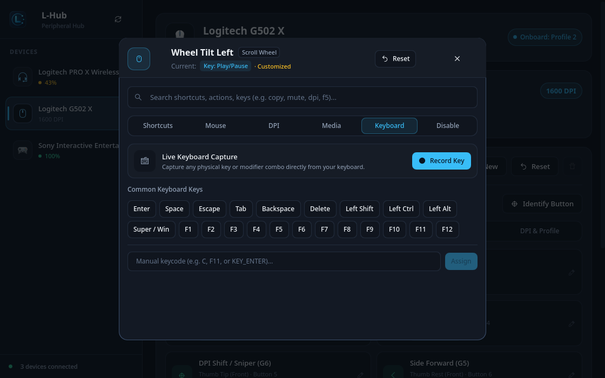

# L-Hub

A sleek, modular peripheral control center for Linux (KDE Plasma & Kirigami).

L-Hub provides a unified, native interface to configure gaming mice and headsets and monitor the battery of other wireless peripherals on Linux, with KDE system tray integration.

> [!WARNING]
> **Work in Progress (WIP)**  
> L-Hub is currently in active early development. Features, UI elements, and internal APIs may change rapidly. Some functions are experimental or partially implemented, and you may encounter bugs or unsupported hardware configurations. Feedback, issue reports, and contributions are very welcome!



---

## Features

- **Gaming Mice (via `libratbag` / `ratbagd` & HID++ 2.0)**
  - **DPI Management**: Switch between active DPI resolution steps or change DPI on the fly (including direct HID++ 2.0 runtime DPI for supported Logitech mice).
  - **Button Remapping**: Remap buttons to standard mouse clicks, keyboard keys/shortcuts, media controls, DPI cycle, sniper mode, or disable buttons.
  - **Interactive Button Tester**: Press physical buttons on your mouse to immediately highlight and identify them in the UI — uses raw USB HID (`/dev/hidraw*`) so custom keybinds, media keys, and shortcuts are recognized too.
  - **Custom & On-Board Profiles**: Create, save, switch, and delete per-device profiles (stored in `~/.config/lhub/profiles.json`), track live Logitech HID++ on-board profile changes, or restore defaults.

- **Gaming Headsets (via `headsetcontrol`)**
  - **Live Battery Status**: Real-time battery percentage readout and remaining battery runtime estimation.
  - **Sidetone Adjustment**: Control mic monitoring / loopback level with a responsive slider.

- **Universal Peripheral Monitoring (via `UPower`)**
  - Automatic detection and battery level monitoring for wireless mice, keyboards, and Bluetooth peripherals.

- **Desktop & System Tray Integration**
  - Dark-themed KDE Plasma / Kirigami (Qt 6) interface.
  - System tray icon displaying connected device battery levels at a glance.
  - Automatic desktop notifications on low battery warnings (below 20%) and on-board profile switches.

---

## Supported Devices

L-Hub is not locked to a single vendor or device model — hardware support comes from its underlying Linux backends:

- **Mice**: Any gaming mouse supported by [`libratbag`](https://github.com/libratbag/libratbag/tree/master/data/devices) (Logitech G, Razer, SteelSeries, Glorious, Roccat, etc.).
- **Headsets**: Any headset supported by [`HeadsetControl`](https://github.com/Sapd/HeadsetControl#supported-headsets) (Logitech, Corsair, SteelSeries, HyperX, Razer, etc.).
- **Battery-only fallback**: Any wireless peripheral exposed via `UPower`.

> [!NOTE]
> **Current hardware caveats:**
> - Detailed physical button names and the 11-button factory-reset layout are currently tailored to the **Logitech G502** series. Other `libratbag`-supported mice still work for DPI and button remapping, using generic button labels (`Button 6`, `Button 7`, etc.).
> - Direct **HID++ 2.0** features (runtime DPI and live on-board profile notifications) currently target wired/direct Logitech USB devices (`0xFF` device index).

---

## Screenshots

### Headset & Battery Control


### Button Remapping & Live Key Capture


---

## Roadmap

Planned improvements:

- [ ] **Broader Mouse Layout Support**: Per-model button metadata & safe factory-reset defaults beyond the Logitech G502 series
- [ ] **Wireless HID++ Receiver Support**: Extend live HID++ 2.0 profile/DPI tracking to Lightspeed / Unifying / Bolt dongles
- [ ] **Advanced Macros & Key Sequences**: Multi-step macro editor in the remap dialog
- [ ] **Packaging**: AUR `PKGBUILD`, Flatpak, or AppImage for easier installation

---

## System Requirements

L-Hub relies on established Linux hardware daemons and libraries:

| Dependency | Purpose | Required? |
|---|---|---|
| **Python** (>= 3.10) | Application runtime | Yes |
| **PySide6** (Qt 6) | GUI framework | Yes |
| **Kirigami** & **qqc2-desktop-style** | KDE UI components & styling | Yes |
| **libratbag** (`ratbagd`) | Mouse configuration daemon | Recommended (for mice) |
| **headsetcontrol** | Headset battery & sidetone CLI | Recommended (for headsets) |
| **upower** | System battery monitoring daemon | Optional (fallback) |

---

## Installation & Setup

### 1. Install System Dependencies

#### Arch Linux / CachyOS / Manjaro:
```bash
sudo pacman -S libratbag headsetcontrol kirigami qqc2-desktop-style python-pyside6
```

#### Fedora:
```bash
sudo dnf install libratbag-ratbagd headsetcontrol kf6-kirigami python3-pyside6
```

#### Ubuntu / Debian:
```bash
sudo apt install ratbagd kirigami2-dev python3-pyside6.qtquick
# Note: headsetcontrol may need to be installed from its GitHub repository or PPA
```

### 2. Enable Daemons

Make sure the `ratbagd` system daemon is running:

```bash
sudo systemctl enable --now ratbagd
```

> [!NOTE]
> If your headset is not detected by `headsetcontrol`, ensure you have installed the udev rules provided by the `headsetcontrol` package or repository so your user has permission to access the device.

---

### 3. Install L-Hub

Clone the repository and run the installer script:

```bash
git clone https://github.com/Laykes/l-hub.git
cd l-hub
./install.sh
```

This installs the launcher (`~/.local/bin/l-hub`), application icon, and desktop entry so **L-Hub** appears in your application menu / KRunner / Kickoff and can be pinned to your taskbar.

> [!NOTE]
> The launcher runs directly from the cloned repository directory, so keep the `l-hub` folder in place after installing (and pull updates with `git pull`).

To uninstall later:

```bash
./install.sh --uninstall
```

---

## Running L-Hub

Launch **L-Hub** from your application menu or KRunner, or run it from a terminal (if `~/.local/bin` is in your `PATH`):

```bash
l-hub
```

Alternatively, you can run it directly from the repository without installing the desktop entry:

```bash
python3 -m lhub
```

---

## Development & Testing

Run the test suite with Python's built-in unittest runner:

```bash
python3 -m unittest discover -s tests
```

---

## Architecture

```
lhub/
├── backends/          # Hardware abstraction layer
│   ├── base.py        # Generic Device & Capability models
│   ├── ratbag.py      # libratbag / ratbagctl integration for mice
│   ├── hidpp.py       # Logitech HID++ 2.0 runtime DPI & live onboard profile events
│   ├── hid_input.py   # Read-only raw USB HID monitor for button identification
│   ├── headset.py     # HeadsetControl integration for headsets
│   └── upower.py      # UPower fallback for wireless devices
├── profiles.py        # JSON-based persistent profile management
├── manager.py         # DeviceManager orchestrating backends, signals, & events
├── tray.py            # QSystemTrayIcon with battery status & notifications
├── qml/               # Kirigami / QtQuick user interface
│   ├── main.qml       # Main application window & dialogs
│   ├── DeviceCard.qml # Card component representing a peripheral
│   ├── RemapDialog.qml# Button remapping interface
│   ├── Theme.qml      # Dark theme palette & styling tokens
│   └── UiButton.qml   # Reusable styled button component
└── main.py            # Application entry point & Qt event loop
```

---

## License

This project is licensed under the **GNU General Public License v3.0 or later** ([GPL-3.0-or-later](https://www.gnu.org/licenses/gpl-3.0.html)).
