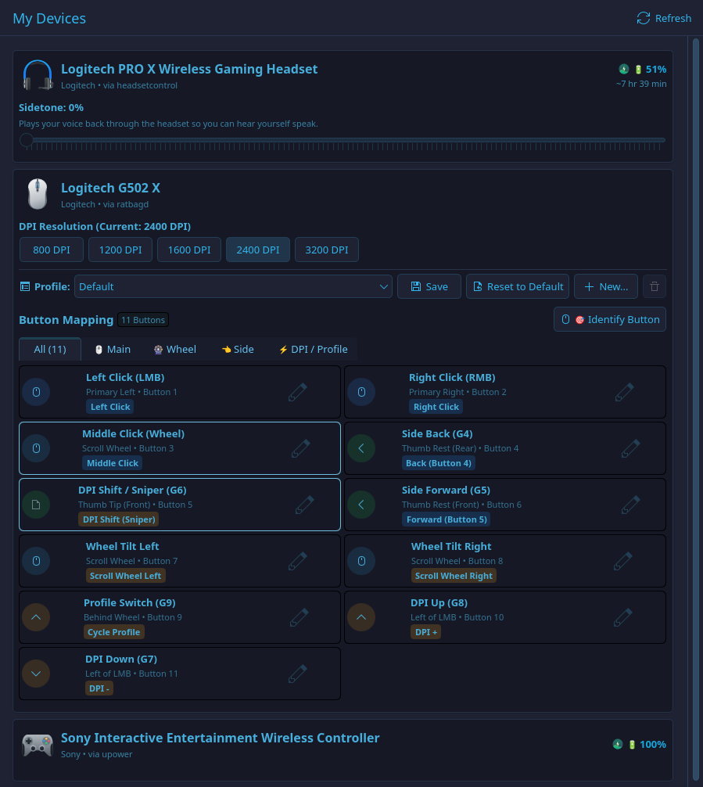

# L-Hub

A sleek, modular peripheral control center for Linux (KDE Plasma & Kirigami).

L-Hub provides a unified, native interface to manage gaming mice, headsets, keyboards, and other peripherals on Linux with seamless KDE system tray integration.

> [!WARNING]
> **Work in Progress (WIP)**  
> L-Hub is currently in active early development. Features, UI elements, and internal APIs may change rapidly. Some functions are experimental or partially implemented, and you may encounter bugs or unsupported hardware configurations. Feedback, issue reports, and contributions are very welcome!



---

## Features

- **Gaming Mice (via `libratbag` / `ratbagd`)**
  - **DPI Management**: Switch between active DPI resolution steps or configure presets on the fly.
  - **Button Remapping**: Remap buttons to standard mouse clicks, keyboard keys/shortcuts, media controls, DPI cycle, sniper mode, or disable buttons.
  - **Interactive Button Tester**: Press physical buttons on your mouse to immediately highlight and identify their internal index in the UI.
  - **Custom Profiles**: Create, save, switch, and delete per-device profiles (stored in `~/.config/lhub/profiles.json`), or restore factory defaults anytime.

- **Gaming Headsets (via `headsetcontrol`)**
  - **Live Battery Status**: Real-time battery percentage readout and remaining battery runtime estimation.
  - **Sidetone Adjustment**: Control mic monitoring / loopback level with a responsive slider.

- **Universal Peripheral Monitoring (via `UPower`)**
  - Automatic detection and battery level monitoring for wireless mice, keyboards, and bluetooth peripherals.

- **Desktop & System Tray Integration**
  - Native KDE Plasma / Kirigami interface following system color schemes and dark/light modes.
  - System tray icon displaying connected device battery levels at a glance.
  - Automatic desktop notifications on low battery warnings (below 20%).

---

## Status & Roadmap

The following capabilities are planned or currently under development:

- [x] Basic mouse DPI switching and button remapping
- [x] Application-level profile manager
- [x] Interactive button detection & tester
- [x] Headset battery & sidetone control
- [x] System tray & low battery notifications
- [ ] **RGB / LED Lighting Control** (ratbag & OpenRGB integration)
- [ ] **Advanced Macros & Key Sequences**
- [ ] **Hardware-specific settings** (polling rate, debounce time, angle snapping, lift-off distance)
- [ ] **Flatpak / AppImage packages** for easy distribution

---

## System Requirements

L-Hub relies on established Linux hardware daemons and libraries:

| Dependency | Purpose | Required? |
|---|---|---|
| **Python** (>= 3.10) | Application runtime | Yes |
| **PySide6** (Qt 6) | GUI framework | Yes |
| **Kirigami** & **qqc2-desktop-style** | KDE UI components & styling | Yes |
| **libratbag** (`ratbagd`) | Mouse configuration daemon | Recommended (for mice) |
| **headsetcontrol** | Headset battery & sidetone CLI | Recommended (for headsets) |
| **upower** | System battery monitoring daemon | Optional (fallback) |

---

## Installation & Setup

### 1. Install System Dependencies

#### Arch Linux / CachyOS / Manjaro:
```bash
sudo pacman -S libratbag headsetcontrol kirigami qqc2-desktop-style python-pyside6
```

#### Fedora:
```bash
sudo dnf install libratbag-ratbagd headsetcontrol kf6-kirigami python3-pyside6
```

#### Ubuntu / Debian:
```bash
sudo apt install ratbagd kirigami2-dev python3-pyside6.qtquick
# Note: headsetcontrol may need to be installed from its GitHub repository or PPA
```

### 2. Enable Daemons

Make sure the `ratbagd` system daemon is running:

```bash
sudo systemctl enable --now ratbagd
```

> [!NOTE]
> If your headset is not detected by `headsetcontrol`, ensure you have installed the udev rules provided by the `headsetcontrol` package or repository so your user has permission to access the device.

---

### 3. Install L-Hub

Clone the repository:

```bash
git clone https://github.com/laykes/l-hub.git
cd l-hub
```

Install Python dependencies (if not installed via your system package manager):

```bash
pip install -e .
```

---

## Running L-Hub

Start the application directly from the repository:

```bash
python3 -m lhub
```

Or, if installed with `pip install -e .`:

```bash
l-hub
```

### Desktop Entry

To launch L-Hub from your desktop application launcher (KRunner, Kickoff, GNOME Shell, etc.), copy the desktop file to your user applications folder:

```bash
cp io.github.lhub.LHub.desktop ~/.local/share/applications/
```

---

## Development & Testing

Run the test suite with Python's built-in unittest runner:

```bash
python3 -m unittest discover -s tests
```

---

## Architecture

```
lhub/
├── backends/          # Hardware abstraction layer
│   ├── base.py        # Generic Device & Capability models
│   ├── ratbag.py      # libratbag / ratbagctl integration for mice
│   ├── headset.py     # HeadsetControl integration for headsets
│   └── upower.py      # UPower fallback for wireless devices
├── profiles.py        # JSON-based persistent profile management
├── manager.py         # DeviceManager orchestrating backends, signals, & events
├── tray.py            # QSystemTrayIcon with battery status & notifications
├── qml/               # Kirigami / QtQuick user interface
│   ├── main.qml       # Main application window & dialogs
│   ├── DeviceCard.qml # Card component representing a peripheral
│   └── RemapDialog.qml# Button remapping interface
└── main.py            # Application entry point & Qt event loop
```

---

## License

This project is licensed under the **GNU General Public License v3.0 or later** ([GPL-3.0-or-later](https://www.gnu.org/licenses/gpl-3.0.html)).
