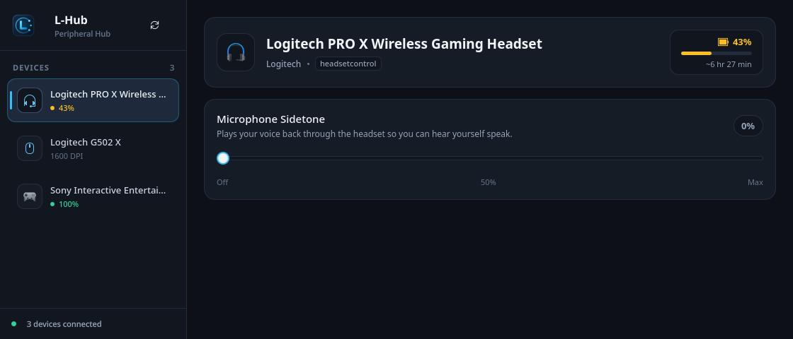

# L-Hub

A sleek, modular peripheral control center for Linux (KDE Plasma & Kirigami).

L-Hub provides a unified, native interface to configure gaming mice, headsets, and USB microphones, and monitor the battery of wireless peripherals on Linux, with KDE system tray integration.

> [!WARNING]
> **Work in Progress (WIP)**  
> L-Hub is currently in active early development. Features, UI elements, and internal APIs may change rapidly. Some functions are experimental or partially implemented, and you may encounter bugs or unsupported hardware configurations. Feedback, issue reports, and contributions are very welcome!


---

## Features

- **Gaming Mice (via `libratbag` / `ratbagd` D-Bus & HID++ 2.0)**
  - **DPI Management**: Switch between active DPI resolution steps or change DPI on the fly (including direct HID++ 2.0 runtime DPI for wired and wireless Logitech mice).
  - **Button Remapping**: Remap buttons to standard mouse clicks, keyboard keys/shortcuts, media controls, DPI cycle, sniper mode, or disable buttons.
  - **Interactive Button Tester**: Press physical buttons on your mouse to immediately highlight and identify them in the UI — uses raw USB HID (`/dev/hidraw*`) so custom keybinds, media keys, and shortcuts are recognized too.
  - **Custom & On-Board Profiles**: Create, save, switch, and delete per-device profiles (stored in `~/.config/lhub/profiles.json`), track live Logitech HID++ on-board profile changes (wired and wireless receivers), or restore safe defaults.
  - **Data-Driven Device Layouts**: Bundled button layouts and factory-reset defaults in JSON, with custom user overrides in `~/.config/lhub/devices/`.

- **Gaming Headsets (via `headsetcontrol`)**
  - **Live Battery Status**: Real-time battery percentage readout and remaining battery runtime estimation.
  - **Sidetone Adjustment**: Control mic monitoring / loopback level with a responsive slider (persisted per headset).
  - **Auto-Sleep / Inactive Time**: Configure headset inactivity shutdown timers where supported (persisted per headset).

- **USB Microphones (via PipeWire)**
  - **Input Gain & Mute**: Adjust microphone gain (0–150% with boost) and toggle mute.
  - **Native 6-Band PipeWire Equalizer**: Built-in biquad filter-chain EQ (`80 Hz`–`10 kHz`) with bypass toggle and quick presets (*Flat*, *Broadcast*, *Discord*, *Warm Voice*, *Radio*).
  - **High-Pass Filter (Low-Cut)**: Configurable `40–250 Hz` filter to reduce desk rumble, bumps, and plosives.
  - **Virtual EQ Source & Live Voice Test**: Set the processed PipeWire EQ node as your default microphone and monitor your processed voice in real time via `pw-loopback`.

- **Universal Peripheral Monitoring (via `UPower` D-Bus)**
  - Automatic detection and battery level monitoring for wireless mice, keyboards, and Bluetooth peripherals.

- **Desktop, Hotplug & System Integration**
  - Dark-themed KDE Plasma / Kirigami (Qt 6) interface with single-instance window activation.
  - Event-driven hotplugging via D-Bus (`ratbagd`, `UPower`) and PipeWire (`pactl subscribe`).
  - Built-in **System Health Check** that flags missing daemons, device permission issues, or connected mice missed by `ratbagd`.
  - System tray icon displaying connected device battery levels at a glance, with desktop notifications for low battery warnings and on-board profile switches.
  - Persistent **Settings** dialog (`~/.config/lhub/settings.json`) for XDG autostart, start minimized, configurable low-battery threshold, notification toggles, and polling interval.

---

## Supported Devices

L-Hub is not locked to a single vendor or device model — hardware support comes from its underlying Linux backends:

- **Mice**: Any gaming mouse supported by [`libratbag`](https://github.com/libratbag/libratbag/tree/master/data/devices) (Logitech G, Razer, SteelSeries, Glorious, Roccat, etc.).
- **Headsets**: Any headset supported by [`HeadsetControl`](https://github.com/Sapd/HeadsetControl#supported-headsets) (Logitech, Corsair, SteelSeries, HyperX, Razer, etc.).
- **USB Microphones**: Standalone USB microphones exposed as PipeWire audio sources (with headsets, webcams, and game controllers filtered out automatically).
- **Battery-only fallback**: Any wireless peripheral exposed via `UPower`.

> [!NOTE]
> **Hardware layout & HID++ notes:**
> - Bundled button metadata and factory-reset layouts are currently included for the **Logitech G502** series, **Logitech G305 / G304**, and **Logitech G Pro X Superlight**. Other `libratbag`-supported mice work for DPI and button remapping using standard fallback labels (`Button 6`, `Button 7`, etc.), and you can add custom JSON definitions in `~/.config/lhub/devices/`.
> - Direct **HID++ 2.0** features (runtime DPI and live on-board profile notifications) support both wired/direct Logitech USB devices (`0xFF`) and paired wireless devices behind Logitech **Lightspeed**, **Unifying**, **Bolt**, and **Nano** receivers (slots 1–6).

---

## Screenshots

### Headset & Battery Control


### Button Remapping & Live Key Capture


---

## Roadmap

Completed milestones:

- [x] **Data-Driven Mouse Layouts**: JSON-based per-model button metadata & factory-reset defaults (with user overrides in `~/.config/lhub/devices/`)
- [x] **Direct D-Bus Backends & Hotplugging**: Native `ratbagd` & `UPower` D-Bus integration with event-driven device hotplugging
- [x] **App Settings, Autostart & System Health Diagnostics**: Configurable settings dialog, XDG autostart, `--minimized` mode, and built-in backend diagnostics
- [x] **Wireless HID++ 2.0 Receiver Support**: Live HID++ 2.0 profile & runtime DPI support over Lightspeed, Unifying, Bolt, and Nano receivers
- [x] **PipeWire USB Microphone Support**: Input gain, native 6-band EQ with presets, high-pass filter, and live voice monitoring

Planned improvements:

- [ ] **Expanded Hardware Capabilities**: Mouse polling rate, RGB/LED controls, and headset EQ
- [ ] **Interactive System Tray Menu**: Quick DPI/profile switching and device controls directly from the tray
- [ ] **Advanced Macros & Profile Exchange**: Multi-step macro editor, profile import/export, and app-based auto-profiles
- [ ] **Packaging**: AUR `PKGBUILD`, Flatpak, or AppImage for easier installation

---

## System Requirements

L-Hub relies on established Linux hardware daemons and libraries:

| Dependency | Purpose | Required? |
|---|---|---|
| **Python** (>= 3.10) | Application runtime | Yes |
| **PySide6** (Qt 6) | GUI framework | Yes |
| **Kirigami** & **qqc2-desktop-style** | KDE UI components & styling | Yes |
| **jeepney** (>= 0.8.0) | Pure-Python D-Bus client for `ratbagd` & `UPower` | Yes |
| **libratbag** (`ratbagd`) | Mouse configuration daemon | Recommended (for mice) |
| **headsetcontrol** | Headset battery, sidetone & auto-sleep CLI | Recommended (for headsets) |
| **PipeWire** (`pipewire`, `pw-cli`, `pw-dump`, `pw-loopback`, `pactl`) | USB microphone EQ & live voice monitoring | Optional (for microphones) |
| **upower** | System battery monitoring daemon | Optional (fallback) |

---

## Installation & Setup

### 1. Install System Dependencies

#### Arch Linux / CachyOS / Manjaro:
```bash
sudo pacman -S libratbag headsetcontrol kirigami qqc2-desktop-style python-pyside6 python-jeepney
# PipeWire (pipewire, pipewire-pulse / libpulse) is typically preinstalled on KDE Plasma
```

#### Fedora:
```bash
sudo dnf install libratbag-ratbagd headsetcontrol kf6-kirigami python3-pyside6 python3-jeepney
# Optional for USB microphone support (typically preinstalled): pipewire pipewire-utils pulseaudio-utils
```

#### Ubuntu / Debian:
```bash
sudo apt install ratbagd qml6-module-org-kde-kirigami python3-pyside6.qtquick python3-jeepney
# Optional for USB microphone support: pipewire-bin pulseaudio-utils
# Note: headsetcontrol may need to be installed from its GitHub repository or PPA
```

### 2. Enable Daemons

Make sure the `ratbagd` system daemon is running:

```bash
sudo systemctl enable --now ratbagd
```

> [!NOTE]
> If your headset is not detected by `headsetcontrol`, ensure you have installed the udev rules provided by the `headsetcontrol` package or repository so your user has permission to access the device.

---

### 3. Install L-Hub

Clone the repository and run the installer script:

```bash
git clone https://github.com/Laykes/l-hub.git
cd l-hub
./install.sh
```

This installs the launcher (`~/.local/bin/l-hub`), application icon, and desktop entry so **L-Hub** appears in your application menu / KRunner / Kickoff and can be pinned to your taskbar.

> [!NOTE]
> The launcher runs directly from the cloned repository directory, so keep the `l-hub` folder in place after installing (and pull updates with `git pull`).

To uninstall later:

```bash
./install.sh --uninstall
```

---

## Running L-Hub

Launch **L-Hub** from your application menu or KRunner, or run it from a terminal (if `~/.local/bin` is in your `PATH`):

```bash
l-hub
```

Alternatively, run it directly from the repository without installing the desktop entry:

```bash
python3 -m lhub
```

Supported CLI flags:

- `--minimized` — Start minimized to the system tray without showing the main window
- `--debug` — Enable verbose debug logging to stderr

---

## Development & Testing

Run the test suite with Python's built-in unittest runner (all hardware/system calls are mocked, so tests run without physical peripherals or running daemons):

```bash
python3 -m unittest discover -s tests
```

---

## Architecture

```
lhub/
├── backends/              # Hardware abstraction layer
│   ├── base.py            # Generic Device, Capability, Battery, DPI & Mic models
│   ├── dbus_client.py     # Shared system D-Bus client & signal subscriptions (jeepney)
│   ├── evdev_codes.py     # Linux evdev keycode <-> key name translation
│   ├── ratbag.py          # Direct ratbagd D-Bus integration for mice
│   ├── hidpp.py           # Logitech HID++ 2.0 runtime DPI & onboard profiles (wired + wireless)
│   ├── hid_input.py       # Read-only raw USB HID monitor for button identification
│   ├── headset.py         # HeadsetControl integration for headsets
│   ├── microphone.py      # PipeWire USB microphone backend with filter-chain EQ & monitoring
│   └── upower.py          # Direct UPower D-Bus fallback for wireless battery status
├── data/
│   └── devices/           # Bundled JSON mouse button layouts & factory-reset defaults
├── device_layouts.py      # Layout loader & resolver (bundled + ~/.config/lhub/devices/)
├── button_tester.py       # Interactive physical button tester controller
├── keymap.py              # Qt key / shortcut <-> ratbag action mapping
├── serializers.py         # Device-to-QML dictionary serialization
├── profiles.py            # JSON-based persistent profile management (~/.config/lhub/profiles.json)
├── settings.py            # Persistent app & headset settings (~/.config/lhub/settings.json) & autostart
├── health.py              # System health diagnostics for backends & permissions
├── logging_config.py      # Centralized stderr logging configuration
├── single_instance.py     # Single-instance guard & window activation
├── manager.py             # DeviceManager orchestrating backends, hotplug, signals & state
├── tray.py                # QSystemTrayIcon with battery status & desktop notifications
├── qml/                   # Kirigami / QtQuick user interface
│   ├── main.qml           # Main application window, sidebar & health diagnostics banner
│   ├── DeviceCard.qml     # Device overview container composing section components
│   ├── RemapDialog.qml    # Button remapping dialog
│   ├── SettingsDialog.qml # Application settings & autostart dialog
│   ├── Theme.qml          # Dark theme palette & styling tokens
│   ├── UiButton.qml       # Reusable styled button component
│   └── components/        # Modular UI sections (BatteryHeader, ProfileBar, DpiSection,
│                          # ButtonGrid, HeadsetSection, MicrophoneSection, ActionPresetGrid,
│                          # KeyCaptureBox)
└── main.py                # Application entry point, CLI flags & Qt event loop
```

---

## License

This project is licensed under the **GNU General Public License v3.0 or later** ([GPL-3.0-or-later](https://www.gnu.org/licenses/gpl-3.0.html)).
